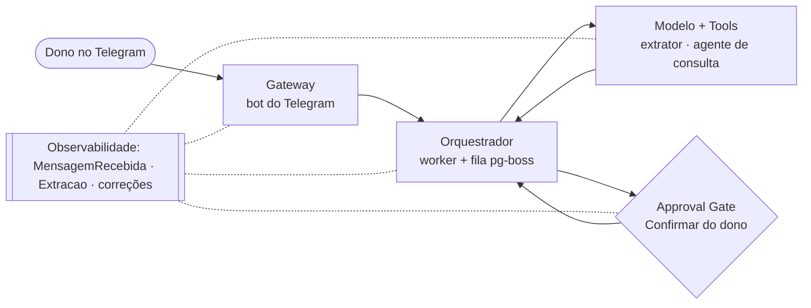

# Missão #01 — Fundamentos de Arquitetura AI-First

> Caso: Anotaí. Diagrama de referência, classificação pelo framework de 3 perguntas e orçamento de
> trade-off por componente.

## Passo 1 — Diagrama de Referência

Processo: lançar uma despesa (ou informar uma operação, como pagar a fatura) mandando um áudio ou um
texto ao bot do Telegram. Hoje isso é uma planilha manual que eu abandono depois de um ou dois dias
sem lançar.

- **Gateway** — o bot do Telegram. Ignora chat que não é o meu, descarta reentrega pela chave
  `canal` + `id_externo` (RN-14) e grava a mensagem e a enfileira antes de qualquer chamada de IA.
  Botão e comando (`/mes`, `/tetos`, `/limite`) seguem sem IA.
- **Orquestrador** — o worker, que é código, não modelo. Consome a fila, chama o extrator, valida a
  saída (RN-30), roteia pela intenção, aplica as regras de negócio e responde por template (RN-31).
- **Modelo + Tools/RAG** — o extrator: uma chamada multimodal que recebe o áudio ou o texto, as
  Categorias elegíveis, os apelidos dos Cartões e a data de hoje, e devolve uma proposta num contrato
  JSON fechado. Para pergunta aberta, o agente de consulta, com ferramentas que só leem. Não há RAG: o
  contexto é a lista fechada enviada em cada chamada.
- **Approval Gate** — eu, por botão, antes de pagar fatura, estornar, quitar parcelamento, registrar
  receita ou apagar (RN-23), de gravar valor alto (RN-20) e de gravar parcela sem distinção entre
  total e parcela (RN-2).
- **Observabilidade** (transversal) — `MensagemRecebida` com `criada_em` e `respondida_em`, para a
  latência de ponta a ponta (M-3); `Extracao` com modelo, versão do prompt, saída bruta, validade,
  custo e latência, para o teto de custo (M-4) e para reprocessar com outro modelo; e cada correção
  minha num campo vindo da IA, que vira caso de eval candidato.

## Passo 2 — Classificação com o Framework de 3 Perguntas

Tarefa híbrida: **informar o pagamento de uma fatura por voz** ("paguei a fatura do Nubank, 2 mil").
Parecia uma tarefa só, mas tem uma parte de interpretação e duas de decisão de negócio.

| Componente/Subtarefa | P1: Regra finita? | P2: Erro caro e irreversível? | P3: Muda com contexto? | Classificação |
|---|---|---|---|---|
| Gateway: autorizar o chat e descartar reentrega | Sim | — | — | Regra |
| Orquestrador: rotear pela intenção e aplicar as RN | Sim | — | — | Regra |
| Extrator: entender um lançamento (valor, categoria, data) | Não | Não (corrijo pelo botão, sem prazo) | Sim | Agente |
| Pagar fatura por voz (híbrida, parte 1): entender intenção, cartão e valor | Não | Sim (muda fatura e limite, e o PRD não tem como desfazer) | Sim | Agente + Approval Gate obrigatório |
| Pagar fatura por voz (híbrida, parte 2): achar as Faturas fechadas com saldo | Sim | — | — | Regra |
| Pagar fatura por voz (híbrida, parte 3): aplicar da mais antiga para a mais nova (RN-26) | Sim | — | — | Regra |
| Agente de consulta: responder pergunta aberta | Não | Não (só lê) | Sim | Agente |

Sem decompor, "pagar fatura" pareceria toda agente. Só a leitura da fala é ambígua; achar a fatura e
aplicar o pagamento são regras, e o gate fica entre a leitura e a regra.

## Passo 3 — Orçamento de Trade-off por Componente

| Componente | Latência | Custo | Precisão | Eixo inegociável |
|---|---|---|---|---|
| Gateway | Baixa (crítica): sinalizar o recebimento em até 1 s | Baixo (sem IA) | N/A | Latência |
| Orquestrador | Baixa | Baixo (código) | Alta: nada gravado duas vezes (RN-14) | Precisão |
| Modelo: extrator | p95 até 10 s, cedível a 20 s no plano B | Fatia de 70% do teto, cerca de R$ 0,13 por mensagem | Acerto composto ≥ 85% | Precisão (é a última concessão do plano B) |
| Tools: agente de consulta | Até 20 s | Fatia de 15% do teto; para ao esgotá-la | ≥ 90%, números vindos do código | Custo (para antes de comer a reserva dos lançamentos) |
| Approval Gate | Alta tolerância (botões não expiram) | N/A | N/A | N/A (decisão minha) |

O extrator é o único lugar onde aceito pagar mais (até R$ 40 no plano B) para não perder precisão,
porque erro de leitura vira correção, e correção é o atrito que o produto existe para tirar.

## Reflexão final — um sinal de mudança

Modelo + Tools: se o alerta de 80% do teto de custo disparar em dois meses seguidos com o volume
dentro das 110 mensagens previstas, o extrator multimodal de uma etapa deixou de caber e é hora de
medir o pipeline de duas etapas (transcrição e depois classificação).
