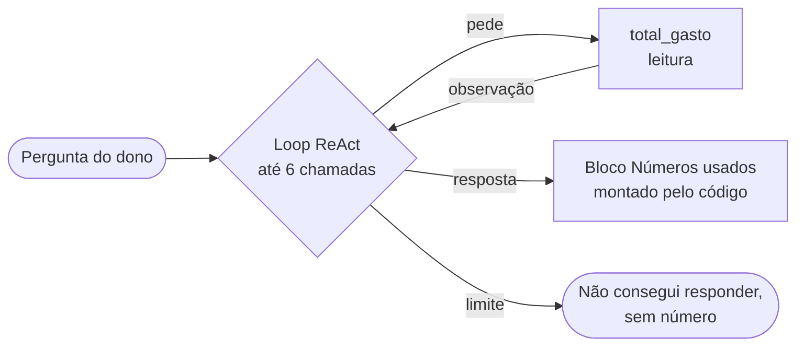

# Missão #02 — Arquiteturas Single-Agent

> Caso: Anotaí. Protótipo de agente único calibrado em memória, loop, reflexão e ferramentas, com
> schema tipado e critério de parada.

## Passo 1 — Protótipo calibrado

Tarefa: responder a uma pergunta aberta minha sobre os meus gastos, como *"quanto gastei com Uber em
julho, agosto e setembro?"*. Hoje eu filtraria e somaria na planilha. É o agente de consulta que o
M1 já classificou como Agente: ele só lê, e o resto do Anotaí não tem agente nenhum.



| Componente | Nível | Justificativa |
|---|---|---|
| Memória | Curto prazo, só dentro da pergunta | Cada pergunta é independente e o dado vive no banco; lembrar de uma resposta anterior traria um total que já mudou com os lançamentos seguintes |
| Loop (ReAct) | Sim, até 6 chamadas de ferramenta | Perguntas por vários meses ou comparações pedem mais de uma consulta antes de responder; o teto de 6 é o da RN-32 |
| Reflexão | Superfície, feita pelo código | Os números da resposta precisam estar nos resultados das ferramentas. O código monta o bloco Números usados e, se o texto divergir, vale o bloco (RN-32). Uma segunda passada do modelo gastaria a fatia de 15% sem trazer fonte nova |
| Ferramentas | Uma: `total_gasto` | O exemplo do PRD e as perguntas de "quanto gastei" se resolvem com total filtrado por período. As outras ferramentas do PRD (lista, faturas, limite, tetos) ficam fora do protótipo |

## Passo 2 — Schema da ferramenta

Ferramenta de **leitura**: só soma itens já gravados, por uma conexão somente leitura (RN-32). Não
passa pelo Approval Gate, porque não muda estado nenhum. Os `enum` de categoria e de cartão são
montados, a cada pergunta, a partir das Categorias elegíveis e dos Cartões ativos do cadastro.

```json
{
  "name": "total_gasto",
  "description": "Soma o que o dono gastou num período, por data de competência, com filtros opcionais. Use para qualquer pergunta de quanto foi gasto num mês, numa categoria, num estabelecimento, num eixo ou num meio de pagamento. Não use para limite de cartão, tetos ou faturas.",
  "parameters": {
    "type": "object",
    "properties": {
      "data_inicio":     { "type": "string", "format": "date", "description": "primeiro dia, AAAA-MM-DD" },
      "data_fim":        { "type": "string", "format": "date", "description": "último dia, inclusive, AAAA-MM-DD" },
      "categoria":       { "type": "string", "enum": ["<Categorias elegíveis do cadastro>"] },
      "estabelecimento": { "type": "string", "description": "comparado sem acento e sem diferença de maiúsculas" },
      "eixo":            { "type": "string", "enum": ["essencial", "nao_essencial", "a_classificar"] },
      "meio_pagamento":  { "type": "string", "enum": ["debito", "credito", "pix", "dinheiro"] },
      "cartao_apelido":  { "type": "string", "enum": ["<apelidos dos Cartões ativos>"] }
    },
    "required": ["data_inicio", "data_fim"]
  }
}
```

Retorno: `{ "total": "123.45", "quantidade_itens": 3, "periodo": { "inicio": "...", "fim": "..." }, "filtros": { ... } }`,
com o total em reais como texto decimal (dinheiro nunca é ponto flutuante). Parâmetro inválido volta
como `{ "erro": "..." }`, que o agente lê como observação.

## Passo 3 — Critério de parada

- **Limite**: 6 chamadas de ferramenta por pergunta (RN-32). Como toda volta que não é a resposta
  final pede ao menos uma ferramenta, isso limita o loop a 7 chamadas ao modelo.
- **No limite sem resposta**: o loop para no código, não no modelo. O bot responde que não conseguiu
  responder, sem nenhum número, e sugere `/mes`, `/tetos` e `/limite` (PRD §10). Nada é gravado, e o
  log registra o motivo da parada.

## Passo 4 — Implementação em JavaScript

Código em [`src/`](../src/): `agente-consulta.js` (loop e ferramenta), `openrouter.js` (chamada ao
modelo `google/gemini-3.5-flash-lite` com `fetch`) e `dados.js` (base **sintética**: o Anotaí ainda
não tem dado real, e dado financeiro meu não entra em repositório público).

`src/agente-consulta.js:100` — chamada real ao modelo, com o schema do Passo 2, em loop:

```js
for (let volta = 1; ; volta++) {
  const { mensagem, usage } = await chat({ modelo: MODELO_AGENTE, mensagens, tools: [TOOL_TOTAL_GASTO] });
```

`src/agente-consulta.js:116` — o limite do Passo 3, verificado no código antes de executar a ferramenta:

```js
if (chamadas >= MAX_CHAMADAS_FERRAMENTA) {
  console.log(`[Loop] limite de ${MAX_CHAMADAS_FERRAMENTA} chamadas de ferramenta atingido sem resposta`);
  console.log('[Agente:consulta] Resposta: Não consegui responder a essa pergunta. Tente /mes, /tetos ou /limite.');
```

Execução ([outputs/agente-consulta-01.md](../outputs/agente-consulta-01.md), US$ 0,000353):

```text
[Agente:consulta] Pergunta: "quanto gastei com Uber em julho, agosto e setembro?"
[Loop] volta 1, chamada 1/6: total_gasto({"data_inicio":"2026-07-01","estabelecimento":"uber","data_fim":"2026-09-30"})
[Ferramenta] → {"total":"144.50","quantidade_itens":5,"periodo":{"inicio":"2026-07-01","fim":"2026-09-30"},"filtros":{"estabelecimento":"uber"}}
[Loop] volta 2: resposta final, depois de 1 chamada(s) de ferramenta
[Agente:consulta] Resposta: R$ 144,50
[Números usados]
  total_gasto {"data_inicio":"2026-07-01","estabelecimento":"uber","data_fim":"2026-09-30"} → R$ 144.50
```
