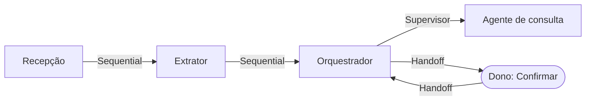

# Missão #03 — Arquiteturas Multi-Agent

> Caso: Anotaí. Padrões de orquestração por dependência, falha e compensação por agente, e
> comunicação assíncrona entre agentes.

## Passo 1 — Padrões mapeados

Processo: informar um pagamento de fatura ao bot ("paguei a fatura do Nubank, 2 mil"). Cinco partes
precisam concordar sobre o estado da mesma mensagem e da mesma fatura: a **Recepção** (bot do
Telegram, que grava a mensagem), o **Extrator** (a chamada de IA), o **Orquestrador** (o worker, que
aplica as regras), o **agente de consulta** do M2 e **eu**, que confirmo a operação. Só o Extrator e o
agente de consulta usam modelo; os outros são código, e eu sou pessoa. Nenhuma mensagem pode virar
dois pagamentos, nem um pagamento sem o meu Confirmar.



| Dependência (de → para) | Padrão | Justificativa |
|---|---|---|
| Recepção → Extrator | Sequential | O Extrator só roda sobre mensagem já gravada; a fila separa o recebimento (1 s) da extração (até 10 s) |
| Extrator → Orquestrador | Sequential | O Orquestrador relê a Extracao válida; ficam separados para que um retry da fase aplicar nunca chame a IA de novo (RN-14) |
| Orquestrador → agente de consulta | Supervisor | A intenção extraída decide quem trata: regra de lançamento, regra de operação ou o agente (PRD §7) |
| Orquestrador → Dono → Orquestrador | Handoff | A operação muda de dono: só executa depois do meu Confirmar (RN-23), e a InteracaoPendente carrega o que já foi entendido |

Parallel existe só entre os gastos de uma mesma mensagem, dentro do Orquestrador (PRD §7), e não
entre agentes. Hierarchical e Group Chat não se aplicam: há um dono só e nenhum par com autoridade
igual para debater. Extrator e Orquestrador poderiam ser um agente só em qualidade, mas não em
custo: juntos, cada retry pagaria de novo a chamada de IA.

## Passo 2 — Falha e compensação por agente

| Agente | Timeout | Máx. tentativas | Espera ou segue sem? (CAP) | Idempotente? |
|---|---|---|---|---|
| Recepção | 1 s para gravar (o recebimento é sinalizado em até 1 s) | Sem limite, com espera crescente: o Telegram retém a atualização não confirmada (PRD §11) | Espera: não confirma ao Telegram sem gravar | Sim, chave `canal` + `id_externo` (RN-14) |
| Extrator | 10 s por chamada (alvo de p95 até medir o overhead, RN-13) | 5 com backoff em cerca de 1 h na falha transitória; 0 na de conteúdo e na de orçamento (PRD §9) | Espera: nenhuma Despesa sem Extracao válida; aviso a mim uma vez | Sim: com Extracao válida gravada, o retry não chama a IA (RN-14) |
| Orquestrador | 5 s por aplicação (só banco, sem IA) | As 5 do job da fila | Espera: tudo ou nada na transação | Sim, chave `mensagem_id` + `indice_no_lote` (RN-14) |
| Agente de consulta | 20 s por pergunta (PRD §10) | 0: responde que não conseguiu, sem número | Segue sem: sugere `/mes`, `/tetos`, `/limite` | Sim, só lê (RN-32) |
| Dono (Confirmar) | Nenhum: botões não expiram (RN-23) | — | Espera: nada executa sem o toque | Sim se o toque só executa com a pendência aberta e a fecha na mesma transação; o PRD não dá chave única ao PagamentoFatura |

| Etapa sequencial | Ação compensatória específica |
|---|---|
| Recepção → Extrator | Se a extração falha por conteúdo, a mensagem fica `falhou` com o tipo da falha e o bot oferece Tentar de novo. A mensagem gravada nunca é apagada (PRD §11) |
| Extrator → Orquestrador | Se o Orquestrador acha um campo inaplicável, salva o resto em vez de descartar: categoria fora das elegíveis vai para A classificar (RN-28), valor ausente vira pendência que pede só o valor (RN-19), cartão desconhecido vira escolha por botões (RN-6) |
| Orquestrador → Dono | Se no toque o alvo mudou (a fatura já foi paga), a revalidação não executa, cancela a pendência e mostra o estado atual (RN-23). Pagamento já aplicado não tem desfazer no PRD |

## Passo 3 — Comunicação assíncrona

| Evento | Dado carregado | Quem emite | Quem escuta |
|---|---|---|---|
| `mensagem:recebida` | `{ mensagem_id, texto }` | Recepção | Extrator |
| `extracao:valida` | `{ mensagem_id, extracao_id, proposta }` | Extrator | Orquestrador |
| `confirmacao:pedida` | `{ interacao_id, resumo }` | Orquestrador | Dono |
| `confirmacao:respondida` | `{ interacao_id, decisao }` | Dono | Orquestrador |

Código em [`src/fila.js`](../src/fila.js), sem chamada de modelo: o Extrator devolve uma proposta
fixa no contrato do PRD §10, porque aqui o que se mostra é a troca de eventos.

`src/fila.js:49` e `src/fila.js:53` — a Recepção publica, o Extrator escuta, sem um conhecer o outro:

```js
  fila.emit('mensagem:recebida', { mensagem_id: mensagem.id, texto });
// ...
fila.on('mensagem:recebida', ({ mensagem_id, texto }) => {
```

`src/fila.js:89` — o Orquestrador só executa com a pendência aberta, o que torna o toque idempotente:

```js
fila.on('confirmacao:respondida', ({ interacao_id, decisao }) => {
  const pendencia = db.pendencias.get(interacao_id);
  if (!pendencia || pendencia.status !== 'aberta') {
```

Execução com `stdin: s` ([outputs/fila-01.md](../outputs/fila-01.md)), incluindo a reentrega da
mesma atualização pelo Telegram e um segundo toque no Confirmar:

```text
[Recepção] gravou msg-1 "paguei a fatura do Nubank, 2 mil" e enfileirou
[Agente:Extrator] proposta para "paguei a fatura do Nubank, 2 mil": {"intencao":"pagar_fatura","operacao":{"cartao_apelido":"Nubank","valor":2000}}
[Approval Gate] Pagar R$ 2000,00 no Nubank: fatura 2026-08-28 saldo R$ 1500,00 · fatura 2026-09-28 saldo R$ 1800,00. Confirmar? (s/n)
[Dono] respondeu "s"
[Orquestrador] PagamentoFatura R$ 1500,00 na fatura 2026-08-28 → paga
[Orquestrador] PagamentoFatura R$ 500,00 na fatura 2026-09-28 → paga_parcial, saldo R$ 1300,00
[Recepção] reentrega de telegram:12345:678 descartada (RN-14)
[Orquestrador] int-msg-1 já está concluida; toque repetido ignorado

[Estado] mensagens=1 · pagamentos=2 · fat-ago pago R$ 1500,00 de R$ 1500,00 · fat-set pago R$ 500,00 de R$ 1800,00
```

## Reflexão final — um sinal de mudança

Se as mensagens que esgotam as 5 tentativas do Extrator por falha transitória deixarem de ser queda
rara do provedor e passarem a aparecer toda semana, esperar (consistência) está segurando lançamentos
que eu já esqueci, e o Extrator precisa cair para outro modelo em vez de só esperar mais.
